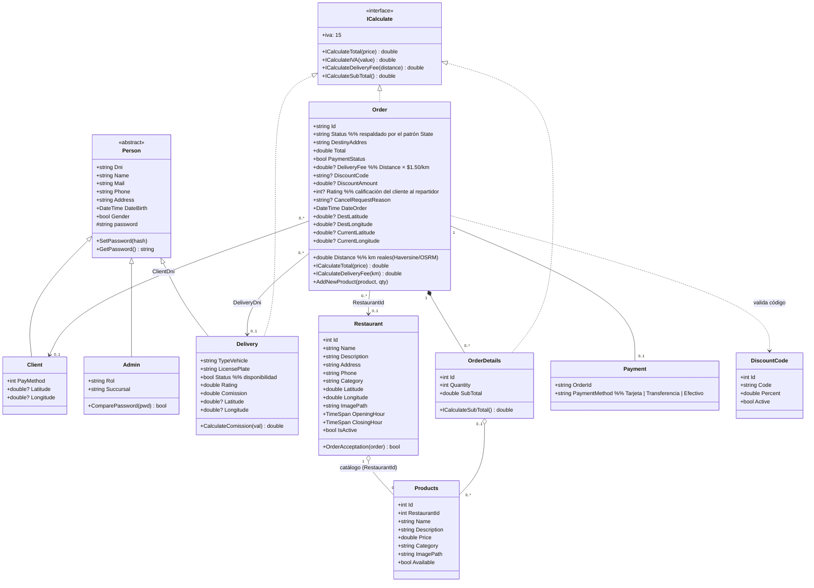
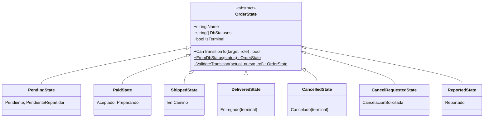
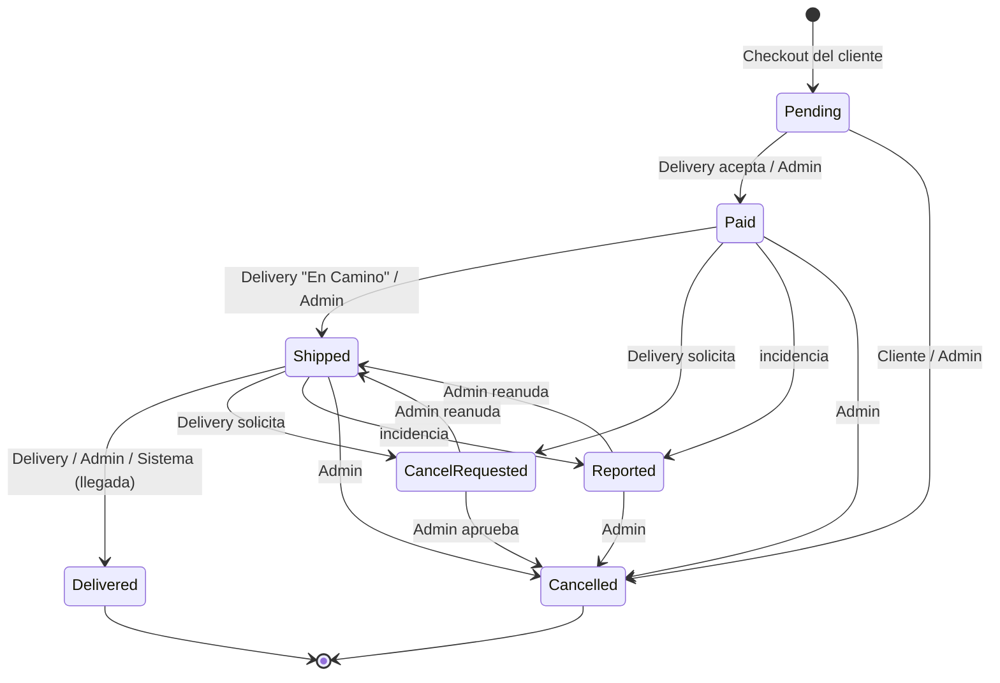
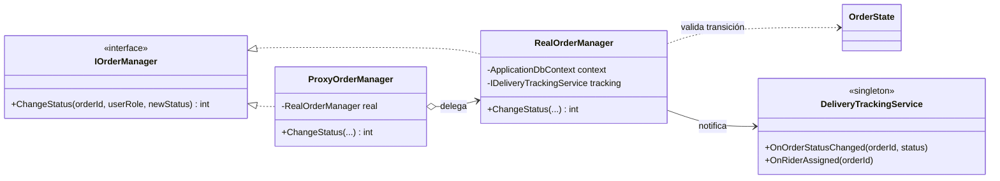
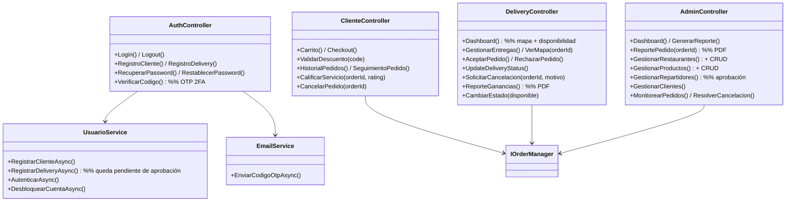

# FlashBite Delivery — Diagrama de Clases

Diagrama del modelo de dominio y de los patrones de diseño del sistema
(**State** para el ciclo de vida del pedido y **Proxy** para el control de
acceso a los cambios de estado). Renderizable con Mermaid (GitHub, VS Code
con la extensión Mermaid, o https://mermaid.live).

## Modelo de dominio

## Patrón State — ciclo de vida del pedido

`Order.Status` (BD, en español) está respaldado por una máquina de estados en
`Models/OrderStates/`. `RealOrderManager` valida cada transición contra estas
clases antes de persistir: una transición inválida lanza excepción y el pedido
no cambia.

### Transiciones permitidas

## Patrón Proxy — control de acceso a cambios de estado

## Servicios y controladores (vista de alto nivel)

